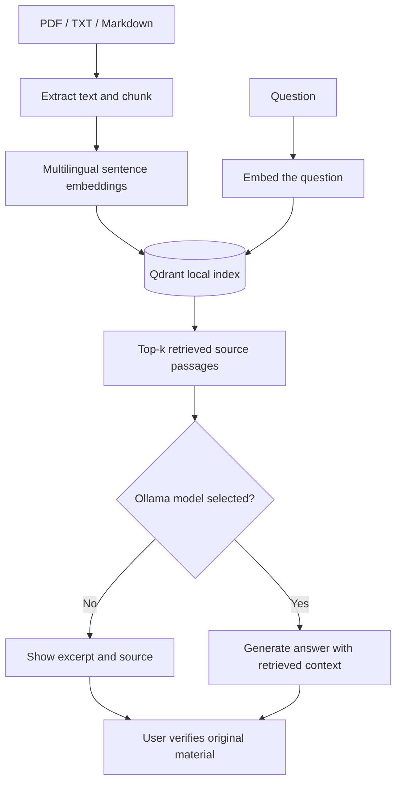

<p align="center"><a href="README.md">English</a> &nbsp; / &nbsp; <a href="README.tr.md">Türkçe</a></p>

<p align="center"></p>

<p align="center"><a href="https://github.com/idginity124/-DeskMind-AI/actions/workflows/tests.yml"></a> &nbsp; <a href="LICENSE"></a> &nbsp; </p>

<p align="center"><strong>Ask your own documents questions. Get the relevant passages, see where they came from, and optionally generate answers using a local LLM.</strong></p>

<p align="center"><a href="#quick-start">Get started</a> &nbsp; · &nbsp; <a href="#inside-the-app">Screenshots</a> &nbsp; · &nbsp; <a href="#how-it-works">Architecture</a> &nbsp; · &nbsp; <a href="docs/QUICKSTART.tr.md">Turkish quick start</a> &nbsp; · &nbsp; <a href="PRIVACY.md">Privacy</a></p>

<p align="center"></p>
<p align="center"><sub>Screenshot of the actual frontend with sample document names; not a claim that the model produced a particular answer.</sub></p>

## Why DeskMind?

Most people have useful information locked away in PDFs and notes. Opening every file and guessing which keyword to search for gets tedious. DeskMind builds a **semantic index** of your local documents so you can ask questions naturally, even across Turkish and English. It shows which passages were retrieved instead of hiding them behind an opaque answer.

It is designed to run on **your own computer** with **no account, no paid API key and no cloud document-upload step**. Generated answers are optional: retrieval-only mode works without Ollama.

| Bring your knowledge | Find the right evidence | Stay in control |
| :--- | :--- | :--- |
| Upload text-based **PDF, TXT and Markdown** files | Multilingual embedding search with **SentenceTransformers + Qdrant** | Data stored in a local workspace; run on **localhost** |
| Separate **Demo** and **My Library** workspaces | Source filenames, similarity scores and **PDF page numbers** | **Ollama is optional**; inspect the original retrieved excerpts |
| Add, list and remove files from the browser | Small reproducible retrieval evaluation script | No sign-in, subscriptions or mandatory external LLM API |

> [!IMPORTANT]
> **Scope: v1.0 — local, single-user application.** DeskMind is an open-source document assistant, **not** a hardened cloud service, an audited security product or a verified fact-checking system. The API has no user authentication; **do not expose it to the internet or an untrusted network**. A model response may be inaccurate even when passages are retrieved.

## Inside the app

<table><tr><td align="center"><br><sub>Desktop: search + document library</sub></td><td align="center"><br><sub>Responsive narrow-screen layout</sub></td></tr></table>

**Three ways to use it:**

1. **Try the demo.** Open the app, choose **Demo**, and click **Örnek belgeleri hazırla** to create an index of included sample documents.
2. **Search your own files.** Switch to **Kütüphanem** (My Library), upload a supported document, and ask a question about its content.
3. **Add local answer generation.** Run Ollama and supply a model name in the UI. Leave the field blank to see the best matching excerpt without generation.

## Quick start

**Requirements:** Linux recommended; Python **3.12 or 3.13** recommended, enough disk space for ML dependencies and embedding weights. First use downloads a multilingual embedding model from Hugging Face. The app then works locally; Ollama models are separate downloads.

### Linux (recommended; Bash or Fish)

```bash
git clone https://github.com/idginity124/-DeskMind-AI.git
cd -- -DeskMind-AI
bash scripts/setup-linux.sh
bash scripts/run-local.sh
```

Open **http://127.0.0.1:8000**. The setup script creates `.venv` inside the project and installs a **CPU PyTorch wheel** to avoid downloading multi-GB NVIDIA CUDA libraries on AMD/CPU systems. It does not install system packages or require `sudo`. Use `PYTHON=python3.12 bash scripts/setup-linux.sh` to pick a Python binary.

> **Fish users:** you do not need to activate the virtual environment for the scripts above. For manual commands use `source .venv/bin/activate.fish`, not Bash's `activate` file.

### Manual install (or other OS)

```bash
python -m venv .venv
# Fish: source .venv/bin/activate.fish
# Bash/Zsh: source .venv/bin/activate
python -m pip install -r requirements-rag.txt
python -m uvicorn api:app --host 127.0.0.1 --port 8000
```

The manual route may download GPU-related libraries depending on your platform and PyTorch package selection. Use the Linux script for a CPU-first install.

### Docker (optional, CPU)

```bash
docker compose up --build
```

Open **http://127.0.0.1:8000**. The example Compose stack stores the app data and model cache in Docker volumes. Ollama running on your **host** is not automatically reachable from `127.0.0.1` inside Docker; use the native install if you want the simplest local LLM setup. Docker builds have not yet been validated in the local test environment.

### Optional: turn passages into an answer with Ollama

Install and start [Ollama](https://ollama.com), then pull a compatible model, for example:

```bash
ollama pull qwen2.5:3b
```

Type `qwen2.5:3b` in DeskMind's model field and ask your question. **Without a model name, DeskMind returns a retrieved passage rather than inventing a generated answer.** Model-generated claims and citations are not independently fact-checked by the app.

## How it works



**Architecture at a glance:** `semantic.py` handles the embedding/retrieval pipeline; `api.py` exposes the local HTTP API; `web/index.html` provides the responsive UI; `benchmark.py` reports retrieval metrics; and `deskmind.py` retains an introductory lexical-search baseline.

<details><summary><b>AI engineering glossary</b></summary>

| Term | Meaning in this project |
| --- | --- |
| **Chunk** | Short piece extracted from a document; smaller than the whole file |
| **Embedding** | Numeric vector representing a text passage; this model outputs 384 dimensions |
| **Indexing** | Converting document chunks into vectors and storing their metadata in Qdrant |
| **Retrieval (top-k)** | Ranking/selecting the most related passages for a user query |
| **RAG** | Retrieval-Augmented Generation: add retrieved passages to a language model prompt |
| **Cosine similarity** | Vector similarity measure; **not** answer correctness probability |
| **Grounding** | Supporting an answer with retrieved source material; still needs verification |
| **Recall@K / MRR** | Retrieval ranking evaluation measures; not generated-answer correctness |

</details>

For a walkthrough of the pipeline and its trade-offs, see [Architecture](docs/ARCHITECTURE.md) and [the Turkish RAG guide](docs/01-RAG-REHBERI.tr.md).

## Testing and evaluation

Run the offline unit and API tests (after installing the dev requirements):

```bash
.venv/bin/python -m pip install -r requirements-dev.txt
.venv/bin/python -m pytest -q
```

**29 automated tests** currently cover chunk splitting, controlled retrieval, upload/delete endpoints, rollback on application errors, invalid files, scanned-PDF rejection, page references and evaluation math. Tests use **fake deterministic embeddings**; they do not prove real model accuracy, Docker compatibility, GPU support or reliability on untrusted PDFs.

You can benchmark the bundled demo corpus after indexing it:

```bash
.venv/bin/python semantic.py index --docs examples/docs
.venv/bin/python benchmark.py --dataset eval/demo_questions.json --data-dir .deskmind --top-k 3
```

The evaluation script prints **Recall@K, MRR@K, hit rate and average query latency** on a tiny labeled sample set. These are educational smoke-test metrics, **not** a general benchmark or guaranteed quality numbers. Reproduce experiments with model versions, corpus, labels, hardware and query count documented.

## API and source layout

| Endpoint | Purpose |
| --- | --- |
| `GET /api/health?workspace=demo` | Index and document counts |
| `GET /api/documents?workspace=personal` | List uploaded personal documents |
| `PUT /api/documents/{filename}` | Upload a personal document (PDF/TXT/MD) |
| `DELETE /api/documents/{filename}` | Delete a personal document and rebuild its index |
| `POST /api/demo/index` | Build the sample corpus |
| `POST /api/ask` | Retrieve results and optionally generate an Ollama response |

The UI includes `X-DeskMind-Client: local-ui` on upload/delete requests. **This is not authentication** and does not make the server safe to expose publicly.

```
DeskMind-AI/
├── api.py                  # Local API and document library
├── semantic.py             # Embeddings, Qdrant and retrieval
├── web/index.html          # Browser UI
├── benchmark.py            # Reproducible demo evaluation
├── eval/                   # Labeled example questions
├── examples/docs/          # Non-private sample corpus
├── tests/                  # Automated tests
├── scripts/                # CPU-first Linux setup and startup
└── docs/                   # Architecture, screenshots and guides
```

## Current limitations

- Only **text-based PDF**, `.txt` and `.md` are supported. **No OCR** for scanned/image-only PDFs. File limit: 8 MB; PDF limit: 100 pages.
- Changes to the personal library **rebuild its full index**, which can become slow on large libraries. Staging + rollback helps with ordinary failures but does not replace backups or crash-safe database transactions.
- Generated citations are **not automatically verified**. Irrelevant results can still rank highly; no reranking or calibrated abstention threshold is implemented.
- Complex tables and multi-column PDFs may be extracted imperfectly. Retrieval uses approximate word chunks, not tokenizer-aware segmentation.
- This is a **single-user, localhost-only** project. No authentication, data encryption at rest, production monitoring or cloud-hosted demo is provided.
- CPU-first setup is tested through automated code paths; performance, Docker builds and real-document handling vary by system. Not a claim of exhaustive compatibility testing.

Read [Privacy](PRIVACY.md), [Security](SECURITY.md), [Contributing](CONTRIBUTING.md), [Changelog](CHANGELOG.md) and [MIT License](LICENSE).

## Planned improvements

Streaming Ollama output · Click-to-open source passages · Incremental indexing · Better PDF tables · Larger multilingual evaluation datasets · Token-aware chunking and reranking · Optional OCR · Packaged installers.

---

<p align="center">Built as an open-source, practical AI engineering project. <a href="https://github.com/idginity124">More projects</a> · <a href="README.tr.md">Türkçe dokümantasyon</a></p>