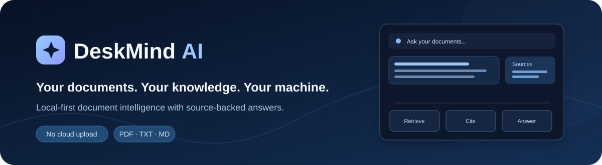
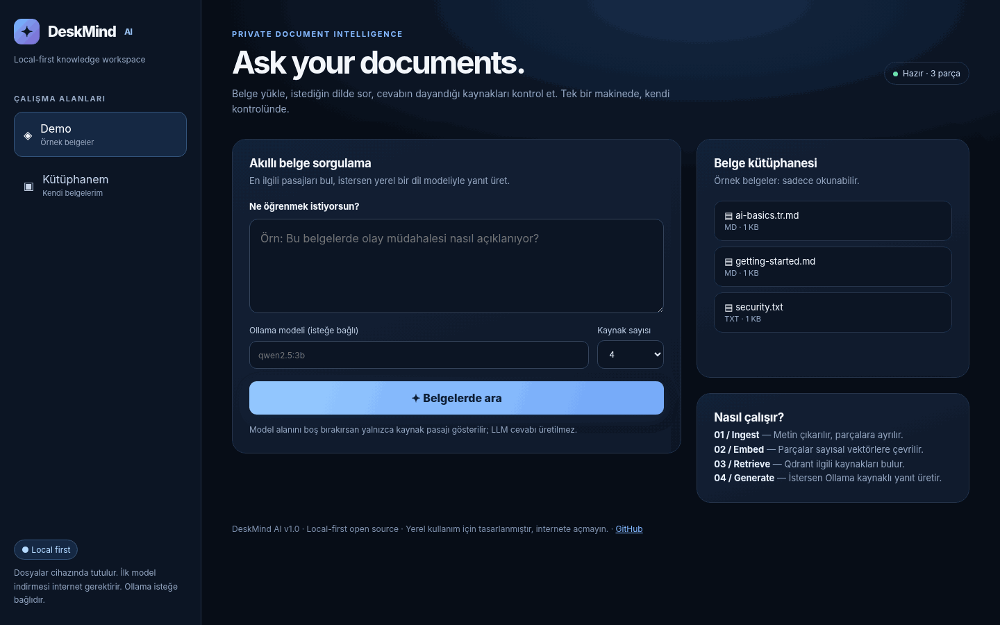
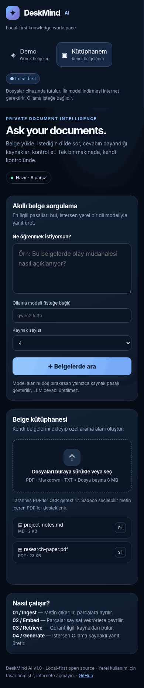
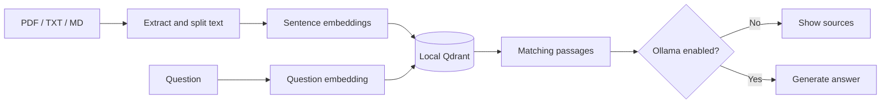

<p align="center"><a href="README.md">English</a> &nbsp; / &nbsp; <a href="README.tr.md">Türkçe</a></p>

<p align="center"></p>

<p align="center">
<a href="https://github.com/idginity124/DeskMind-AI/actions/workflows/tests.yml"></a>
&nbsp; <a href="LICENSE"></a>
</p>

DeskMind is a local search app for PDFs and notes. Add your files, ask a question, and see the passages that match. If you have [Ollama](https://ollama.com) running, you can also get an answer written from those passages.

I started this project as a way to build and understand a RAG pipeline end to end, rather than just call a hosted chatbot API. It now has a small web interface, a document library, and source references you can check yourself.

<p align="center"></p>

<details>
<summary>See the narrow-screen layout</summary>
<p align="center"></p>
</details>

## What it does

- **Search your own documents.** Upload text-based PDFs, TXT files, or Markdown notes from the browser.
- **Find related text, not just matching words.** Multilingual embeddings let you search Turkish and English material together.
- **Show the source.** Results include the filename, the matching text, a similarity score, and a page number for PDFs.
- **Keep workspaces separate.** Try the included demo, then switch to your personal library.
- **Use an LLM only if you want to.** With Ollama configured, DeskMind can turn retrieved passages into a response. Without it, you still get document search.

There is no account to create. The app and its index run on your computer. Model weights are downloaded on first use; uploaded documents are not sent to a hosted LLM by DeskMind.

## Getting started

The easiest setup is on Linux. Python 3.12 or 3.13 is recommended.

```bash
git clone https://github.com/idginity124/DeskMind-AI.git
cd DeskMind-AI
bash scripts/setup-linux.sh
bash scripts/run-local.sh
```

Open **http://127.0.0.1:8000**.

The setup script creates a project-local Python environment and installs CPU PyTorch rather than downloading NVIDIA CUDA packages. It does not modify system Python or require sudo.

If you use Fish, the scripts above still work as written. To activate the environment manually, run `source .venv/bin/activate.fish`.

### Try it with a document

1. Open **Demo** and choose **Örnek belgeleri hazırla** to index the included examples.
2. Ask something about the sample notes. The matching passages should appear with their sources.
3. Switch to **Kütüphanem** to upload one of your own files.
4. Open a result and compare it with the original document. Retrieval scores are not correctness percentages.

### Optional: generate an answer locally

Install and start Ollama, then download a model, for example:

```bash
ollama pull qwen2.5:3b
```

Enter `qwen2.5:3b` in the model field in DeskMind. When the field is empty, the app returns the best retrieved passage instead of generating text.

### Docker

There is also a CPU-oriented Compose setup:

```bash
docker compose up --build
```

Docker builds have not been fully tested across environments. A host Ollama server is not automatically reachable at `127.0.0.1` from inside the container; the native install is the simpler choice for local LLM use.

## Under the hood

DeskMind uses `paraphrase-multilingual-MiniLM-L12-v2` to turn document chunks and questions into 384-dimensional embeddings. Qdrant stores the vectors locally and returns the closest chunks when you search. If Ollama is enabled, those chunks become context for the language model.



The main pieces are fairly small:

| File | Role |
| --- | --- |
| `semantic.py` | Document chunking, embeddings, Qdrant search, optional Ollama calls |
| `api.py` | Local FastAPI routes, uploads, deletes, workspaces |
| `web/index.html` | Browser interface |
| `benchmark.py` | Retrieval measurements on labeled examples |
| `tests/` | Unit and API tests |

See [the architecture notes](docs/ARCHITECTURE.md) for data flow and index recovery details. I also wrote a [Turkish RAG walkthrough](docs/01-RAG-REHBERI.tr.md) while working through the underlying concepts.

## Tests and retrieval checks

After setting up the environment:

```bash
.venv/bin/python -m pip install -r requirements-dev.txt
.venv/bin/python -m pytest -q
```

The current suite contains **29 automated tests** covering document handling, API behavior, extraction, recovery on ordinary errors, and evaluation calculations. Most retrieval tests use deterministic mock embeddings. Passing them does **not** establish real-world search accuracy.

To measure retrieval on the bundled example questions:

```bash
.venv/bin/python semantic.py index --docs examples/docs
.venv/bin/python benchmark.py --dataset eval/demo_questions.json --data-dir .deskmind --top-k 3
```

The script reports Recall@K, MRR@K and query latency. The demo dataset is intentionally tiny, so treat the numbers as a sanity check, not a benchmark claim.

## Current limits

- **Text PDFs only.** Scanned/image-only PDFs need OCR, which is not included yet. Maximum upload size is 8 MB, and PDFs are limited to 100 pages.
- Adding or removing a document rebuilds the personal index. This is fine for a small library but slower as it grows.
- Complex PDF layouts, tables and columns may not extract cleanly.
- Ollama answers are **not fact-checked** and citations are not automatically verified. Always inspect the source passage.
- This is a **single-user localhost app**. It has no login or encryption at rest. Do not expose the server to the internet or an untrusted network.
- Index changes have application-level rollback for ordinary errors, but that does not replace backups or protect against every crash.

I'm working toward better PDF handling, incremental indexing, improved retrieval evaluation and a smoother chat experience. These are plans, not features in this release.

## Contributing and license

Issues, bug reports and small improvements are welcome. Start with [CONTRIBUTING.md](CONTRIBUTING.md). For data handling and deployment caveats, see [PRIVACY.md](PRIVACY.md) and [SECURITY.md](SECURITY.md).

MIT licensed — see [LICENSE](LICENSE). Changes are tracked in [CHANGELOG.md](CHANGELOG.md).

<p align="center"><a href="https://github.com/idginity124">Other projects</a> · <a href="README.tr.md">Türkçe</a></p>
