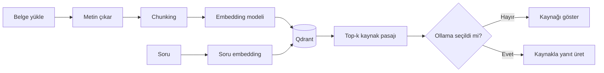

<p align="center"><a href="README.md">English</a> &nbsp; / &nbsp; <a href="README.tr.md">Türkçe</a></p>

<p align="center"></p>

<p align="center"><strong>PDF ve notlarını kendi bilgisayarında arayan, kullandığı kaynakları gösteren, istersen yerel bir dil modeliyle yanıt üreten açık kaynak belge asistanı.</strong></p>

<p align="center"><a href="#hızlı-kurulum">Kurulum</a> · <a href="#uygulama-nasıl-kullanılır">Kullanım</a> · <a href="#sistemin-mimarisi">Mimari</a> · <a href="#sınırlamalar">Sınırlamalar</a> · <a href="docs/01-RAG-REHBERI.tr.md">RAG dersi</a></p>

<p align="center"></p>
<p align="center"><sub>Gerçek web arayüzünün örnek dosya adlarıyla alınmış ekran görüntüsü; yapay zekâ çıktısını gösteren bir demo değildir.</sub></p>

## DeskMind AI ne işe yarar?

Ders notların, teknik dökümanların veya iş belgelerin farklı PDF ve metin dosyalarında olabilir. DeskMind, bu dosyaları tek tek açmak yerine **anlamlarına göre aramanı** sağlar. Türkçe bir soruya karşılık İngilizce belgedeki alakalı bölümü de getirebilir. İstersen bulduğu bölümleri yerel bir Ollama modeline göndererek cevap oluşturur. Dosya adı, PDF sayfası ve kullanılan metni görüp cevabı kendin doğrulayabilirsin.

**Önemli ayrım:** DeskMind internete bağlanan genel amaçlı bir sohbet botu değildir; yüklediğin belgeler üzerinde çalışan bir arama ve isteğe bağlı RAG uygulamasıdır.

| Özellik | Neler yapabilirsin? |
| --- | --- |
| **Belge kütüphanesi** | PDF, `.txt`, `.md` dosyalarını tarayıcıdan yükle, listele, sil |
| **Anlamsal arama** | Aynı kelimeleri kullanmadan ilişkili metinleri bul |
| **Çok dilli destek** | Türkçe/İngilizce sorgu ve belgeleri aynı sistemde ara |
| **Kaynak gösterme** | Dosya adı, metin parçası, skor ve mevcutsa PDF sayfasını gör |
| **Yerel cevap üretme** | Ollama yüklüyse soru ve bulunan kaynaklarla yanıt üret |
| **Gizlilik** | Belgeler ve indeks bilgisayarındaki `.deskmind/` klasöründe kalır |
| **Ölçüm** | Küçük örnek veriyle Recall@K ve MRR sonuçlarını hesapla |

> [!WARNING]
> **Bu v1.0, tek kullanıcılı ve yalnızca yerelde çalıştırılmak üzere tasarlanmıştır.** Kullanıcı hesabı/giriş sistemi yok. Sunucuyu internete açma. Üretilen cevaplar hatalı olabilir; kaynak pasajlarını kontrol et.

## Hızlı kurulum

### CachyOS / Arch / Linux — önerilen yol

Önce depoyu klonla, sonra kurulum betiğini çalıştır:

```bash
git clone https://github.com/idginity124/-DeskMind-AI.git
cd -- -DeskMind-AI
bash scripts/setup-linux.sh
bash scripts/run-local.sh
```

Tarayıcıda `http://127.0.0.1:8000` adresini aç.

**Bu komutlar neden var?**

- `git clone` kaynak kodlarını GitHub'dan bilgisayarına indirir.
- `cd -- -DeskMind-AI` proje klasörüne girer. `--` işareti klasör adının `-` ile başlaması nedeniyle kullanılır.
- `setup-linux.sh` projeye özel `.venv` Python sanal ortamını açar ve bağımlılıkları yükler. AMD ekran kartlı ya da NVIDIA olmayan sistemlerde gereksiz CUDA paketleri yerine CPU PyTorch kullanır.
- `run-local.sh` FastAPI sunucusunu başlatır. Sistem Python'unu değiştirmez.

**Python:** 3.12/3.13 önerilir. Başlangıçta embedding modeli Hugging Face üzerinden indirilir; bu yüzden ilk indeksleme için internet gerekir. İndirme tamamlandığında yerel arama internet olmadan çalışabilir.

Fish Shell'de kendin bir ortamı etkinleştireceksen:

```fish
source .venv/bin/activate.fish
```

Bash için `source .venv/bin/activate` kullanılır; Fish'e Bash komutunu vermek hata üretir.

### Ollama ile yapay zekâ yanıtı (isteğe bağlı)

Yerel Ollama servisi kuruluyken örnek bir model indir:

```bash
ollama pull qwen2.5:3b
```

DeskMind'deki Ollama model alanına `qwen2.5:3b` yaz. Alanı boş bırakırsan sistem **yalnızca en alakalı kaynak parçasını getirir**, yeni bir LLM cevabı üretmez.

### Docker ile deneme

```bash
docker compose up --build
```

Bu yöntem örnek bir **CPU** kurulumu sağlar. Docker konteynerinin içindeki `127.0.0.1`, bilgisayarındaki Ollama sunucusu değildir; Ollama için ek bağlantı ayarı gerekebilir. Docker kurulumu her ortamda henüz doğrulanmadı.

## Uygulama nasıl kullanılır?

1. **Demo:** Uygulamayı ilk açtığında `Demo` alanını seçip `Örnek belgeleri hazırla` düğmesine bas. Örnek dosyalar indekslenir.
2. **Kütüphanem:** Kendi TXT/Markdown veya metin seçilebilir PDF dosyanı yükle. Taranmış, yalnızca resim içeren PDF'lerde şu an OCR yoktur.
3. **Soru sor:** Örneğin, *“Bu dokümanda olay müdahale sürecinin aşamaları nasıl anlatılıyor?”*
4. **Kaynağı incele:** Gelen pasajın dosya adını, ilgili metni ve PDF ise sayfasını kontrol et.
5. **LLM ile cevap al:** İsteğe bağlı Ollama modeli seç; yanıtın dayandığı kaynakları yine doğrula.

Kişisel dosyalar `.deskmind/workspaces/personal/documents/` altında saklanır ve `.gitignore` sayesinde normal Git commit'lerine dahil edilmez. Yine de Git'e eklemeden önce `git status` çıktısını kontrol et.

## Sistemin mimarisi



**Kavramlar:**

- **Chunking:** Uzun bir belgeyi aramaya uygun parçalara ayırmak.
- **Embedding:** Her parçayı anlam ilişkilerini yansıtan sayısal vektöre çevirmek. Kullandığımız çok dilli model 384 boyutlu vektör üretir.
- **Vector database / Qdrant:** Bu vektörleri ve hangi dosyadan geldiklerini saklayan arama katmanı.
- **Retrieval:** Soruyla en alakalı `top-k` parçayı bulmak.
- **Generation:** Dil modelinin bulunan parçalardan doğal dil cevabı oluşturması.
- **RAG:** Retrieval-Augmented Generation; dil modeline dış belgelerden getirilen bilgi eklemek.
- **Cosine similarity:** Vektörlerin yakınlığını gösterir. Örneğin `0.50`, **%50 doğru cevap** demek değildir.
- **Grounding:** Cevabın kaynaklardan destek alması. Referans gösterilmesi tek başına doğruluk garantisi vermez.

Bu konuları örneklerle öğrenmek için [Türkçe RAG rehberine](docs/01-RAG-REHBERI.tr.md) ve [mimari belgesine](docs/ARCHITECTURE.md) bakabilirsin.

## Kod yapısı ve testler

| Dosya | Sorumluluk |
| --- | --- |
| `semantic.py` | Embedding oluşturma, yerel Qdrant'a yazma ve arama |
| `api.py` | Dosya yükleme, silme ve sorgu HTTP API'si |
| `web/index.html` | Masaüstü/mobil uyumlu tarayıcı arayüzü |
| `benchmark.py` | Recall@K, MRR ve gecikme ölçümü |
| `tests/` | Otomatik yazılım testleri |
| `scripts/` | Kurulum ve başlatma betikleri |

```bash
.venv/bin/python -m pip install -r requirements-dev.txt
.venv/bin/python -m pytest -q
```

Bu sürümde **29 otomatik test** bulunuyor. Testler, gerçek embedding modelinin yerine kontrollü sahte vektörler kullanır. Bu nedenle testlerin geçmesi modelin her belgede doğru sonuç vereceğini kanıtlamaz.

Demo indeksini oluşturduktan sonra:

```bash
.venv/bin/python benchmark.py --dataset eval/demo_questions.json --data-dir .deskmind --top-k 3
```

Bu örnek veri kümesi çok küçük. Üretilen kalite metrikleri yalnızca öğretici başlangıç ölçümüdür; genel doğruluk oranı gibi sunulmamalıdır.

## Sınırlamalar

- Metin seçilebilir PDF, TXT ve Markdown desteklenir. **OCR henüz yok**. Dosya başına 8 MB ve PDF için 100 sayfa sınırı var.
- Kütüphaneye belge ekleme/silme tüm kişisel indeksi yeniden oluşturur. Çok büyük arşivlerde yavaşlayabilir.
- PDF tabloları ve çok sütunlu metinlerin çıkarımı kusursuz olmayabilir.
- Yanıt üretimi için Ollama ayrıca kurulmalıdır. Üretilen atıflar otomatik olarak doğrulanmıyor.
- Kimlik doğrulama, çoklu kullanıcı, şifreli depolama ve herkese açık sunucu desteği yoktur. **Sadece `127.0.0.1` üzerinde çalıştır.**
- Yerel indeks değişikliklerinde uygulama düzeyinde geri alma vardır, fakat bilgisayarın aniden kapanması gibi durumlara karşı yedek almak gerekir.

Daha fazla ayrıntı: [Gizlilik](PRIVACY.md) · [Güvenlik](SECURITY.md) · [Katkıda bulunma](CONTRIBUTING.md) · [Değişiklikler](CHANGELOG.md) · [MIT Lisansı](LICENSE).

---

<p align="center"><a href="https://github.com/idginity124">Diğer projeler</a> · <a href="README.md">English README</a></p>