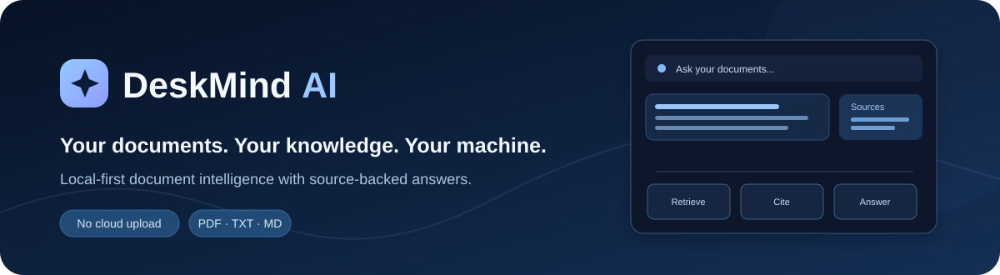
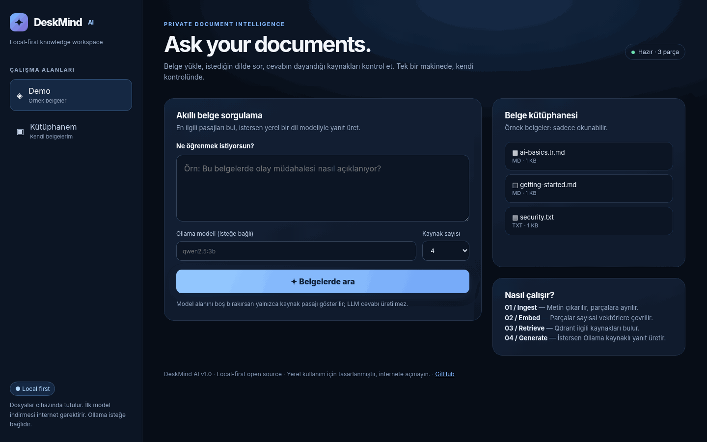
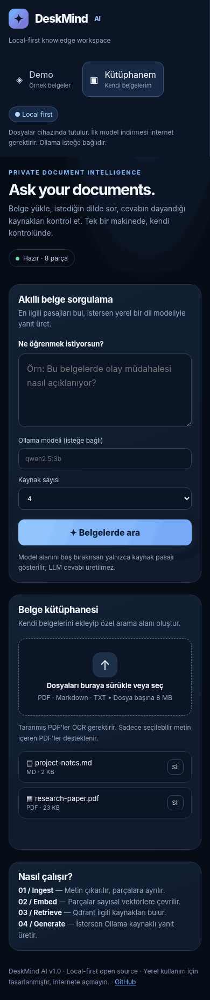
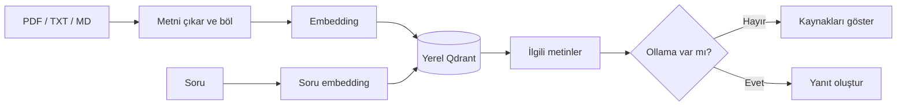

<p align="center"><a href="README.md">English</a> &nbsp; / &nbsp; <a href="README.tr.md">Türkçe</a></p>

<p align="center"></p>

DeskMind, PDF dosyalarında ve notlarda arama yapmak için geliştirdiğim yerel bir uygulama. Dosyalarını ekliyorsun, bir soru soruyorsun, uygulama da ilgili metin parçalarını hangi belgeden aldığını göstererek buluyor. Bilgisayarında Ollama çalışıyorsa bu parçaları kullanarak yanıt da oluşturabiliyor.

Projeye RAG sisteminin nasıl çalıştığını uçtan uca öğrenmek için başladım. Hazır bir sohbet API'si bağlamak yerine belge okuma, metni parçalara ayırma, embedding oluşturma, vektör arama ve kaynak gösterme adımlarını ayrı ayrı geliştirdim. Sonra bunları küçük bir web arayüzünde birleştirdim.

<p align="center"></p>

<details>
<summary>Dar ekran görünümü</summary>
<p align="center"></p>
</details>

## Neler yapabiliyor?

- **Kendi belgelerini ara.** Metin içeren PDF, TXT ve Markdown dosyalarını tarayıcıdan yükleyebilir, listeleyebilir ve silebilirsin.
- **Sadece kelime eşleştirmiyor.** Çok dilli embedding modeliyle Türkçe ve İngilizce belgelerde anlamca yakın parçaları bulabiliyor.
- **Kaynağı gösteriyor.** Dosya adı, ilgili metin, benzerlik skoru ve PDF dosyalarında sayfa numarası sonuçlarda yer alıyor.
- **Örnek belgeler ayrı.** Demo alanında sistemi deneyebilir, sonra kendi kütüphanene geçebilirsin.
- **Ollama isteğe bağlı.** Yerel dil modeli kurmadan da belge araması çalışıyor.

Hesap oluşturman gerekmiyor. Belgeler ve indeks bilgisayarında tutuluyor. İlk kurulumda embedding modelinin ağırlıkları indiriliyor; DeskMind belgelerini bir bulut LLM hizmetine göndermiyor.

## Kurulum

Linux için önerdiğim yol aşağıdaki komutlar. Python 3.12 veya 3.13 kullanmanı öneriyorum.

```bash
git clone https://github.com/idginity124/DeskMind-AI.git
cd DeskMind-AI
bash scripts/setup-linux.sh
bash scripts/run-local.sh
```

Sonra tarayıcıdan **http://127.0.0.1:8000** adresini aç.

Kurulum betiği proje içinde `.venv` oluşturuyor. CPU PyTorch paketini kullanıyor; NVIDIA CUDA paketlerini ayrıca indirmiyor ve sistem Python'una müdahale etmiyor.

Fish Shell kullanıyorsan yukarıdaki betikler yine çalışır. Ortamı elle açman gerekirse `source .venv/bin/activate.fish` yaz.

### İlk belgeyle deneme

1. **Demo** alanında **Örnek belgeleri hazırla** seçeneğine bas.
2. Örnek belgeler hakkında bir soru sor ve çıkan kaynakları incele.
3. **Kütüphanem** alanına geçip kendi PDF veya metin dosyanı yükle.
4. Bulunan parçayı asıl belgeyle karşılaştır. Benzerlik skoru bir doğruluk yüzdesi değil.

### Ollama ile yanıt üretme

Yerel Ollama servisini kurup başlattıktan sonra örneğin şu modeli indirebilirsin:

```bash
ollama pull qwen2.5:3b
```

Uygulamadaki model alanına `qwen2.5:3b` yaz. Bu alan boşsa DeskMind yeni bir yanıt üretmez; en yakın kaynak parçasını getirir.

### Docker seçeneği

```bash
docker compose up --build
```

Bu yapılandırma CPU kullanımı için hazırlandı. Docker kurulumu farklı sistemlerde kapsamlı biçimde test edilmedi. Konteyner içindeki `127.0.0.1`, bilgisayarında çalışan Ollama'ya işaret etmez; ek ağ ayarı gerekir. Yerel LLM için normal Linux kurulumu daha kolay.

## Nasıl çalışıyor?

Önce belge metni çıkarılıyor ve kısa parçalara ayrılıyor. `paraphrase-multilingual-MiniLM-L12-v2` modeli her parçayı 384 boyutlu bir vektöre dönüştürüyor. Bu vektörler Qdrant'ta saklanıyor. Soru sorduğunda aynı model soruyu da vektöre çeviriyor ve en yakın metin parçaları aranıyor.



Bu aşamalar için kullanılan birkaç terim:

- **Chunking:** Uzun belgeyi arama yapılabilecek küçük parçalara ayırma.
- **Embedding:** Metni anlam ilişkilerini taşıyan sayısal vektöre dönüştürme.
- **Retrieval:** Soruyla ilgili parçaları bulup sıralama.
- **RAG:** Bulunan parçaları dil modeline bağlam olarak verip yanıt oluşturma.
- **Cosine similarity:** Vektörlerin yön benzerliğini ölçme. Sonucun `0.50` olması cevabın %50 doğru olduğu anlamına gelmez.

Daha ayrıntılı açıklama için [mimari notlarına](docs/ARCHITECTURE.md) ve [Türkçe RAG rehberine](docs/01-RAG-REHBERI.tr.md) bakabilirsin.

## Kod yapısı

| Dosya | Ne yapıyor? |
| --- | --- |
| `semantic.py` | Metin parçalama, embedding, Qdrant araması ve isteğe bağlı Ollama bağlantısı |
| `api.py` | FastAPI ile dosya yükleme, silme ve soru sorma işlemleri |
| `web/index.html` | Tarayıcı arayüzü |
| `benchmark.py` | Örnek sorularla arama kalitesini ölçme |
| `tests/` | Birim ve API testleri |

## Testler

```bash
.venv/bin/python -m pip install -r requirements-dev.txt
.venv/bin/python -m pytest -q
```

Bu sürümde **29 otomatik test** bulunuyor. Bunlar dosya işlemlerini, API yanıtlarını, hata durumlarını ve bazı değerlendirme hesaplarını kontrol ediyor. Arama testlerinin çoğunda gerçek model yerine sabit, sahte embedding vektörleri kullanılıyor. Testlerin geçmesi, her gerçek PDF'de doğru sonuç alınacağını göstermiyor.

Örnek veri üzerinde arama metriklerini görmek için:

```bash
.venv/bin/python semantic.py index --docs examples/docs
.venv/bin/python benchmark.py --dataset eval/demo_questions.json --data-dir .deskmind --top-k 3
```

Burada Recall@K, MRR@K ve sorgu süresi hesaplanıyor. Veri kümesi küçük olduğundan sonuçları genel performans iddiası olarak sunmuyorum.

## Şu anki sınırlar

- PDF desteği yalnızca **metin seçilebilir dosyalarda** çalışıyor; taranmış PDF'ler için OCR henüz yok. Dosya sınırı 8 MB, PDF sınırı 100 sayfa.
- Kişisel kütüphaneye dosya eklemek veya silmek, tüm indeksi yeniden oluşturuyor. Büyük arşivlerde yavaş olabilir.
- Çok sütunlu PDF'lerde ve karmaşık tablolarda metin sırası bozulabilir.
- Ollama ile üretilen yanıtlar ve atıflar otomatik olarak doğrulanmıyor. Önemli bilgileri kaynağından kontrol etmek gerekiyor.
- Uygulama **tek kullanıcı ve localhost** için tasarlandı. Giriş sistemi ve şifreli depolama yok. Sunucuyu internete veya güvenilmeyen bir ağa açma.
- İndeks güncellemelerinde normal uygulama hataları için geri alma mekanizması var; ani kapanma ve disk sorunlarına karşı yedek yine gerekli.

Daha iyi PDF ayrıştırma, artımlı indeksleme, geniş kapsamlı çok dilli testler ve sohbet deneyimini geliştirmek sonraki işler arasında. Henüz yapılmamış özellikleri bu sürümün parçası olarak göstermiyorum.

## Katkıda bulunma ve lisans

Hata bildirimi ve katkılar için [CONTRIBUTING.md](CONTRIBUTING.md) dosyasına bakabilirsin. Veri saklama ve güvenlik notları [PRIVACY.md](PRIVACY.md) ile [SECURITY.md](SECURITY.md) içinde. Sürüm değişiklikleri [CHANGELOG.md](CHANGELOG.md) dosyasında.

Proje [MIT lisansı](LICENSE) altında yayımlanıyor.

<p align="center"><a href="https://github.com/idginity124">Diğer projelerim</a> · <a href="README.md">English</a></p>
