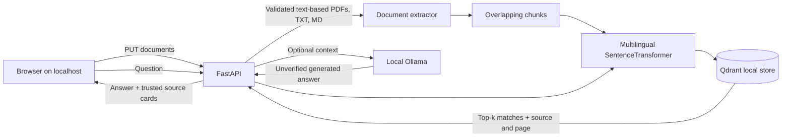

# DeskMind architecture

## Data boundaries
- **Local model:** a SentenceTransformer produces embeddings. Model weights may download from Hugging Face on first use.
- **Local storage:** `.deskmind` stores original personal documents, extracted text, vectors and index metadata. The user controls disk access; content is not encrypted at rest.
- **Generation:** optional Ollama is contacted at `127.0.0.1:11434`. Its model and service must already be installed by the user.
- **API:** trusted localhost hosts only, no account system. This application is not safe for remote/public hosting without a complete security redesign.

## Index integrity
Personal uploads are validated before they are committed. Each reindex is built in a staging directory; the live index is swapped after construction succeeds, with rollback on normal Python errors. Deletes move the original document aside until reindexing completes. This improves resilience to errors but does **not** provide full crash-safe or power-loss durability across every filesystem, nor encryption/backups.

## Retrieval and answer trust
- Each source result retains filename, optional PDF page, excerpt and cosine-based similarity score. This score is not a truth probability.
- The app shows retrieved source cards separately from the LLM response. LLM-generated citations are not automatically verified.
- Uploaded documents are untrusted input, including prompt injection attempts. The prompt directs the LLM to treat them as evidence, not instructions; this is not a complete security guarantee.
- User should verify claims against their original files.
